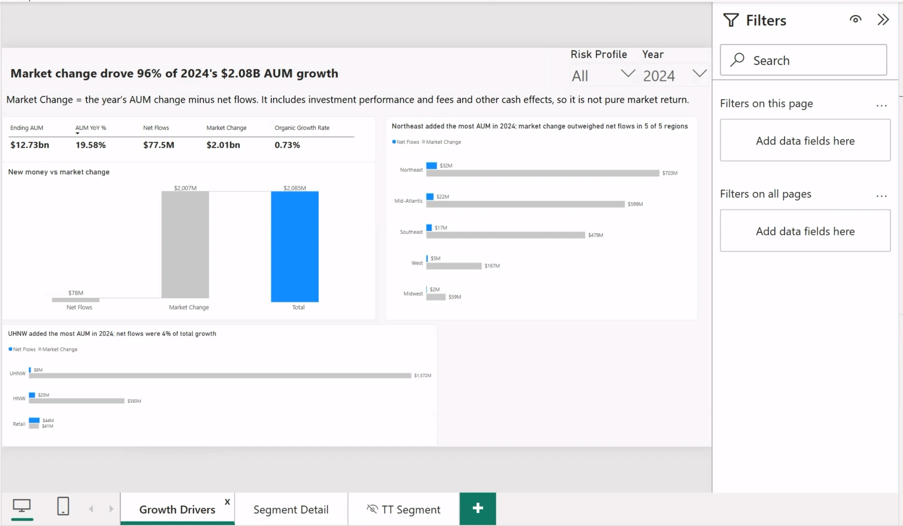
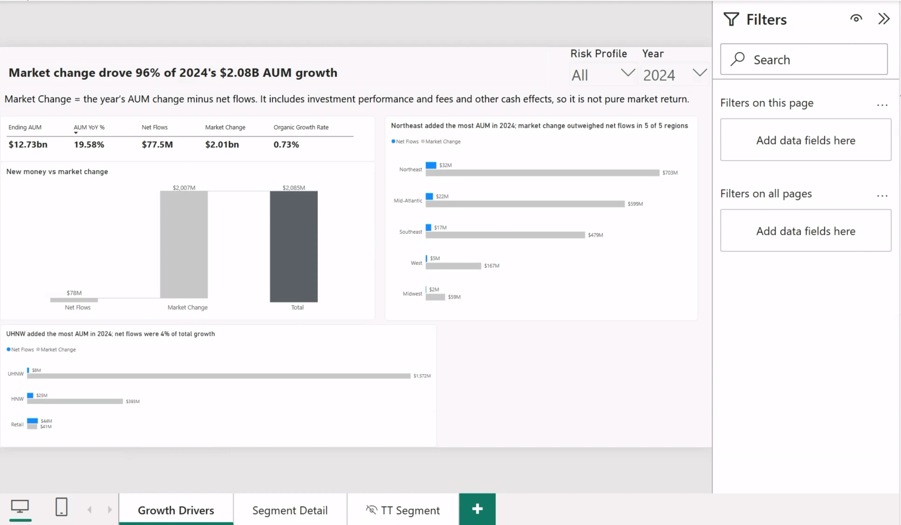

# Design Critique with Claude (Part E)

**Tool:** Claude Desktop
**Input:** screenshots of both pages (`dashboard/page1.png`, `dashboard/page2.png`), the audience and the business question
**Date:** 2026-11-22

## Prompt I used

> This two-page Power BI report is for Wildcat Capital's managing director. It answers: "Where did 2024 growth come from, markets or new money, and which client segments and regions drove it?" Page 1 (Growth Drivers) is the overview; Page 2 (Segment Detail) is a drill-through on client tier.
>
> Critique both pages against the Week 11 checklist: chart choice, preattentive focus (one accent), clutter, axes (bars from zero), sorting, color and accessibility, layout, and insight titles. Then give me the top 3 changes in priority order.

Claude's full reply is saved in [critique_response.md](critique_response.md).

**Claude's top 3:**
1. Make each color mean one thing, with the accent on the message.
2. Swap the region and tier charts to stacked bars, and lead the tier title with the Retail finding.
3. Rebuild Page 2 around the question (add a flows vs market split for the drilled tier) and make the titles dynamic.

## Claude's suggestions and my decisions

| # | Claude's suggestion | Decision | Reason |
|---|---|---|---|
| 1 | **Make blue mean one thing.** On Page 1, blue is Net Flows in the bar charts but the Total in the waterfall. Use blue for Net Flows everywhere, grey for Market Change, and a dark neutral for the Total. | **Adapt** | Correct, and it was the main preattentive problem. A Power BI waterfall can only color by Increase / Decrease / Total, not by category, so Net Flows can't be blue there without also coloring Market Change. I changed the waterfall Total from blue to dark grey. Blue now appears only on Net Flows in the report. (Before/after below.) |
| 2 | **Use stacked bars instead of clustered bars** for tier and region, so one bar shows the total and the mix. | **Reject** | Market Change is negative in some years (2022: −$778M firm-wide), and the Year slicer lets the MD pick those years. Stacked bars with mixed signs are hard to read, which is the reason given in my design plan (Section 3). The totals Claude wants are in the titles and the tooltip (AUM Change, Flow Share of Growth). |
| 3 | **Lead the tier title with the Retail finding:** Retail is the only tier where new money ($44M) beat market change ($41M). | **Adapt** | It's the most decision-relevant segment insight, and it's true for 2024. But the title is a dynamic DAX measure that has to stay true in every year (I tested 2022 and 2023), and the Retail finding is 2024-specific. I kept the title generic and put the Retail finding in the executive summary. The tooltip also shows it (Retail Flow Share of Growth ≈ 52%). |
| 4 | **Remove the all-green status icons** on the Page 2 top 10 table, because they carry no information. | **Reject** | The brief requires conditional formatting on the top 10 table, and the icons are rule-based (red if AUM fell, green if it grew), not relative to the other rows. They are all green because all ten HNW clients grew in 2024; in a year or tier where a large client shrinks, the icon flags it. All-green is itself the finding. |
| 5 | **Add a net flows vs market change split for the drilled tier on Page 2**, since that is the MD's question. | **Accept** | Page 2 showed size, fees and alpha but not the "markets or new money" answer for the segment. I added Net Flows and Market Change to the Page 2 KPI table (Net Flows first, matching Page 1), so a drill on HNW shows $25.2M vs $393.14M. Both values are already reconciled for HNW in `reports/kpi_reconciliation.csv`. |
| 6 | **Round "19.58%" to 19.6%** and use one unit style ($bn vs $B vs $M). | **Adapt** | Agreed on precision: two decimals on a YoY rate is false precision for an MD, so I set AUM YoY % to one decimal (19.6%; the top 10 table now shows 26.1%, 20.6%, …). The mixed units come partly from the DAX titles (FORMAT gives "B") and partly from display units ("bn"), and I left those as they are. The $78M vs $77.5M difference is rounding of the same number, not an error. |
| 7 | **Raise the bar-chart data labels from about 8pt to 10pt** or more; Retail's $44M / $41M labels overlap. | **Reject** | I tried 10pt labels. They overlapped on the short Retail bars and crowded the chart, so I kept the original size. The values are also in the tooltip (TT Segment) and in the reconciliation. |

## Claims Claude got wrong

1. **"Market change is 15–40× larger than net flows, so the blue bars are slivers."** That's true for the regions (22× to 37×) and roughly for HNW (16×), but not for the tiers as a whole. For UHNW, market change is **194×** net flows, and for **Retail it's 0.9×**: Retail's net flows ($44.2M) are *larger* than its market change ($41.5M). Claude's own later point that "Retail is the only tier where new money beat the market" contradicts its 15–40× range. Checked against `data/growth_extract.csv` and `reports/kpi_reconciliation.csv`.
2. **"If these titles are static text boxes, changing a slicer leaves '2024' and '96%' on screen"** and **"'HNW clients — 2024 segment detail'… will still say HNW when someone drills into UHNW."** All of these titles are DAX measures. I tested 2022 ("AUM fell $0.70B in 2022…") and 2023 ("Market change drove 94% of 2023's $1.34B AUM growth") on Page 1, and a UHNW drill-through on Page 2 ("UHNW clients — 2024 segment detail"). Claude couldn't tell from a screenshot, so it assumed they were static.

## Before / after (accepted change)

**Change (suggestion 1):** the waterfall's Total bar was the same blue as Net Flows in the bar charts, so blue meant two different things on Page 1. I recolored the Total to dark grey. Blue now marks only Net Flows across the report.

| Before | After |
|---|---|
|  |  |
