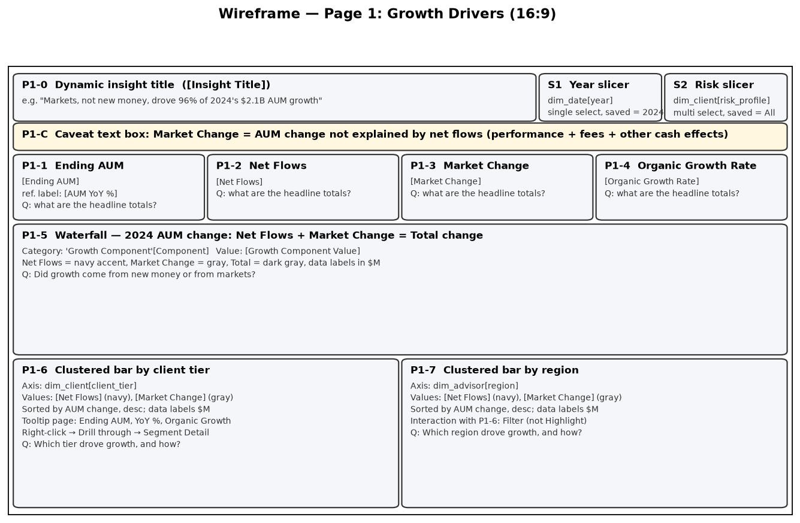
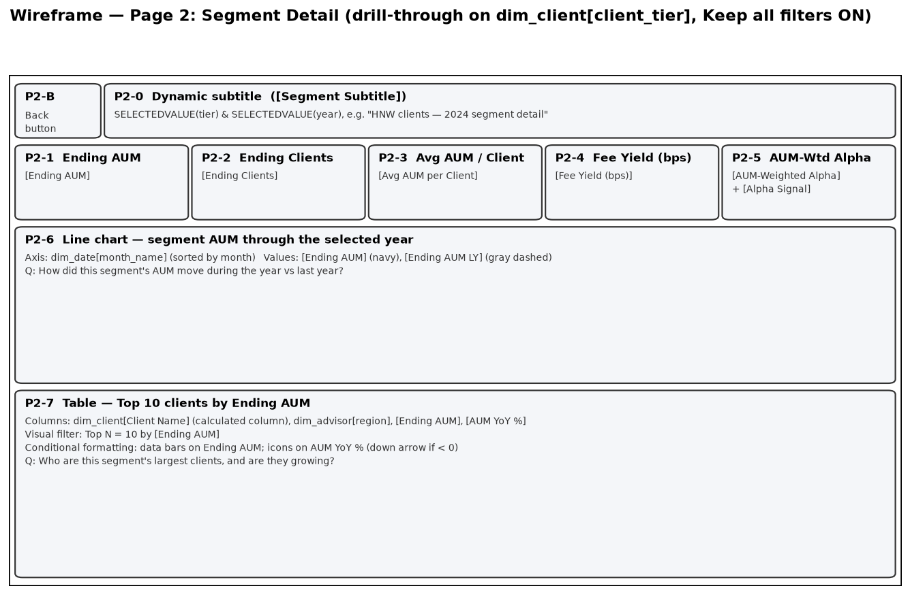
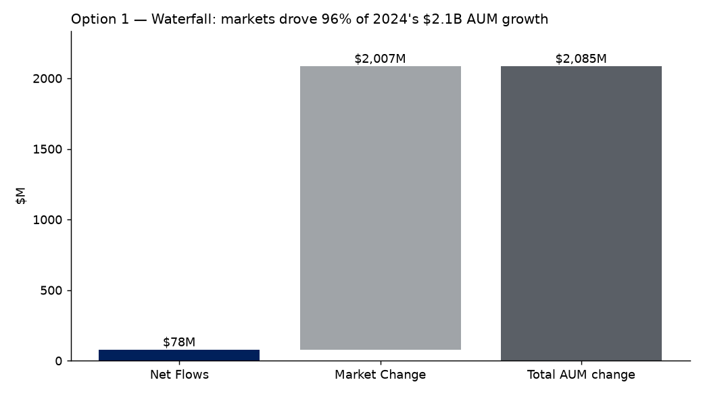
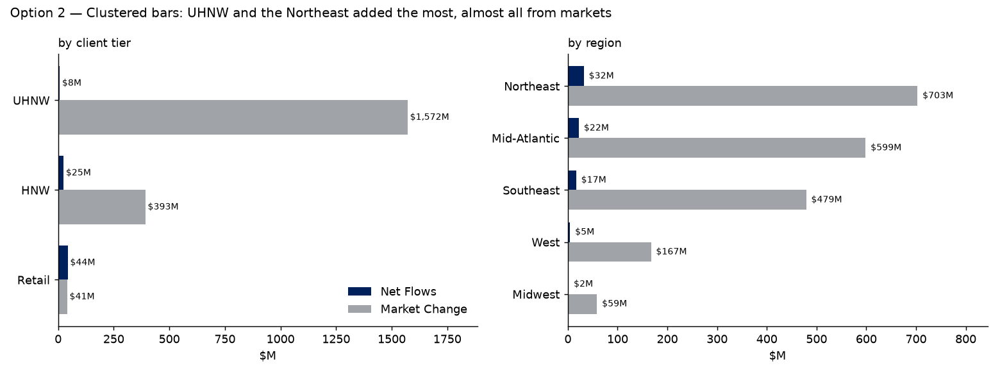
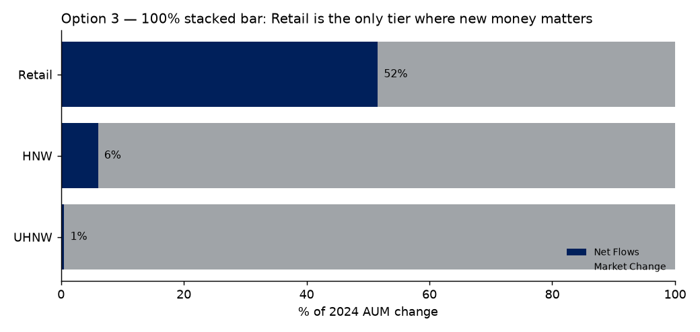

# HW7 Design Plan — Where Did 2024 Growth Come From?

**Report:** two-page Power BI report built from `ICE12.pbix` (the HW6 measure library plus `Market Change`)
**Data used for planning:** `data/growth_extract.csv`, built by `scripts/00_make_extract.py` (Section 5). All numbers below come from that extract. They will be reconciled against Power BI in Part D.

---

## 1. Audience and question

**Audience:** Wildcat Capital's managing director. They review the firm's results once a year and need the answer at a glance, not a data tour.

**Question:** Where did 2024 AUM growth come from, markets or new money, and which client tiers and regions drove it?

**What the reader must conclude in 10 seconds:**
> AUM grew **$2.08B (+19.6%)** to **$12.73B** in 2024, and **96% of that came from market change, not new money**. Net flows added only **$78M** (an organic growth rate of 0.73%). **UHNW** clients and the **Northeast** region added the most dollars. **Retail** is the only tier where new money mattered: about half of its growth came from net flows.

**Key 2024 numbers behind that sentence** (from the extract)

| Slice | Ending AUM | AUM change | Net Flows | Market Change | Share of change from flows |
|---|---:|---:|---:|---:|---:|
| **Firm** | $12,729.6M | $2,084.6M | $77.5M | $2,007.1M | 3.7% |
| UHNW | $9,647.6M | $1,580.6M | $8.1M | $1,572.5M | 0.5% |
| HNW | $2,548.5M | $418.4M | $25.2M | $393.1M | 6.0% |
| Retail | $533.5M | $85.7M | $44.2M | $41.5M | 51.6% |
| Northeast | $4,530.7M | $735.3M | $32.2M | $703.1M | 4.4% |
| Mid-Atlantic | $3,763.9M | $621.0M | $22.2M | $598.8M | 3.6% |
| Southeast | $3,064.4M | $496.0M | $16.8M | $479.3M | 3.4% |
| West | $1,014.7M | $171.8M | $4.6M | $167.3M | 2.7% |
| Midwest | $355.8M | $60.5M | $1.8M | $58.7M | 3.0% |

Every tier and region grew by roughly 19–20%, so the regions differ mainly in **size**, not in growth rate. The page should make the flows-vs-market story the headline and treat the regional ranking as supporting detail.

**Data scope:** 2020–2024 (2020 has no prior year, so its Market Change is blank). There are three tiers (Retail, HNW, UHNW) and five advisor regions (West has 2 advisors and Midwest has 1, so those two are small).

---

## 2. Wireframes

Both wireframes are drawn to Power BI's 16:9 page. Each box is labelled with its visual ID, fields or measures, and the question it answers.

### Page 1 — Growth Drivers


| ID | Visual | Fields / measures | Question it answers |
|---|---|---|---|
| P1-0 | Card (new), category label off, used as the page title | `[Insight Title]` (Section 6) | What is the one-line answer? |
| P1-C | Text box | Static caveat text | What does Market Change include and leave out? |
| P1-1 | Card (new) | `[Ending AUM]`, reference label `[AUM YoY %]` | How large is the firm, and how much did it grow? |
| P1-2 | Card (new) | `[Net Flows]` | How much new money came in (net)? |
| P1-3 | Card (new) | `[Market Change]` | How much of the change was not new money? |
| P1-4 | Card (new) | `[Organic Growth Rate]` | What is new money as a % of starting AUM? |
| P1-5 | Waterfall | Category `'Growth Component'[Component]`; Y `[Growth Component Value]` | Did growth come from new money or markets? |
| P1-6 | Clustered bar | Y-axis `dim_client[client_tier]`; X `[Net Flows]`, `[Market Change]` | Which tier drove growth, and how? |
| P1-7 | Clustered bar | Y-axis `dim_advisor[region]`; X `[Net Flows]`, `[Market Change]` | Which region drove growth, and how? |
| S1 | Slicer (dropdown, single select) | `dim_date[year]`, saved as 2024 | Which year am I looking at? |
| S2 | Slicer (dropdown, multi select) | `dim_client[risk_profile]`, saved as All | Does the story hold for each risk profile? |
| TT | Report-page tooltip (on P1-6, P1-7) | `[Ending AUM]`, `[AUM YoY %]`, `[Organic Growth Rate]`, `[Flow Share of Growth]` | How big is this segment, and how much of its growth was new money? |

**Caveat text (P1-C):**
> *Market Change = the year's AUM change minus net flows. It includes investment performance **and** fees and other cash effects (such as dividends or cash withdrawn as fees), so it is not pure market return.*

### Page 2 — Segment Detail (drill-through)


| ID | Visual | Fields / measures | Question it answers |
|---|---|---|---|
| P2-B | Back button | Built-in Back action | Return to Page 1 |
| P2-0 | Card (new), used as subtitle | `[Segment Subtitle]` | Which segment and year is this? |
| P2-1 | Card | `[Ending AUM]` | How big is this segment? |
| P2-2 | Card | `[Ending Clients]` | How many clients does it have? |
| P2-3 | Card | `[Avg AUM per Client]` | How large is a typical relationship? |
| P2-4 | Card | `[Fee Yield (bps)]` | How much do we earn per dollar managed? |
| P2-5 | Card (new, two values) | `[AUM-Weighted Alpha]`, `[Alpha Signal]` | Are this segment's portfolios beating the benchmark? |
| P2-6 | Line chart | X `dim_date[month_name]` (sorted by `month`); Y `[Ending AUM]`, `[Ending AUM LY]` | How did the segment's AUM move this year vs last year? |
| P2-7 | Table | `dim_client[Client Name]` (new calculated column), `dim_advisor[region]`, `[Ending AUM]`, `[AUM YoY %]`; Top N = 10 by `[Ending AUM]` | Who are the segment's largest clients, and are they growing? |

`dim_client` only has `first_name` and `last_name`, so the table needs a calculated column:
```DAX
Client Name = dim_client[first_name] & " " & dim_client[last_name] & " (#" & dim_client[client_id] & ")"
```
The ID is included so two clients with the same name don't collapse into one row.

---

## 3. Visual choices (Week 11 reasoning)

| ID | Data types | # measures | Analysis type | Why this visual (and what I rejected) |
|---|---|---|---|---|
| P1-1 – P1-4 | One number each | 1 (+1 comparison on P1-1) | KPI / status | A card is the fastest way to read a single value. Only Ending AUM carries a comparison (YoY %), so the one growth figure stands out. |
| P1-5 | Categorical (2 components + total) + quantitative | 1, switched by component | Composition of a change (bridge) | A waterfall is built to show how parts add up to a change, including negative parts (2022's market change was −$778M). It starts at zero and shows only the *change*, not the full balance. If it started at Ending AUM LY ($10.6B), the $78M flows bar would be about 0.7% of the axis and disappear. I rejected a pie: it can't show negatives, and the parts make up a change, not a whole. |
| P1-6 | Categorical (3 tiers) + quantitative | 2 | Comparison across categories, plus composition | Horizontal bars start at zero and are easy to compare by length. I chose clustered over stacked because Market Change can be negative in other years, and stacked bars with mixed signs are hard to read. Sorted by total AUM change, descending. Data labels in $M keep Retail's small bars readable even though UHNW's $1.57B sets the axis. |
| P1-7 | Categorical (5 regions) + quantitative | 2 | Comparison across categories | Same encoding as P1-6 so the reader only learns it once. Sorted the same way. |
| P2-1 – P2-5 | One number each | 1–2 | KPI / status | Same card style as Page 1 for consistency. Alpha Signal sits next to its number so the value and its meaning are read together. |
| P2-6 | Time (month) + quantitative | 2 | Trend | A line is the right encoding for a time series. The LY line in gray, dashed, gives context without a second chart. |
| P2-7 | Categorical (client) + several measures | 2 | Ranking / lookup | A table is right when the reader needs exact values for named clients. Data bars show the ranking; an icon flags any client whose AUM fell. |

**Principles applied across both pages**
- **One accent.** Net Flows (the part the firm can influence) is navy `#00205B` everywhere it appears. Market Change is neutral gray `#A0A4A8`, and totals are dark gray `#5A5F66`. Nothing else is colored.
- **Accessible color.** Navy and gray differ in lightness, not only in hue, so the charts still read in grayscale and for color-blind viewers. Up and down are never shown with red and green alone, and every bar has a data label.
- **Bars from zero.** This is Power BI's default for bar and waterfall charts, and I won't override it.
- **Sorting.** Bars are sorted by total AUM change (descending), never alphabetically.
- **Insight titles.** Each title states the finding, for example "UHNW added the most AUM, almost all from markets", not the field names.
- **Low clutter.** No gridlines on bar charts, data labels instead of x-axis values, and units shown in $M or $B.

---

## 4. Interaction plan

**Slicers**
- **S1 `dim_date[year]`:** dropdown, **single select**, saved as **2024**.
  - It has to be single select: `Ending AUM LY`, `Market Change` and `Organic Growth Rate` only make sense for one year.
  - A visual-level filter on the slicer keeps it to **2021–2024**. In 2020 `[Ending AUM LY]` is blank, DAX treats that blank as 0 in subtraction, and Market Change would show as 2020's whole AUM ($8.1B). This filter is listed in the Part D filter audit.
- **S2 `dim_client[risk_profile]`:** dropdown, multi select, saved as **All**. It lets the MD check whether the growth story holds for conservative and aggressive clients alike.
- **Sync slicers:** both slicers are synced to Page 2, where they are hidden. This way a slicer change on Page 1 also applies on Page 2, on top of what Keep all filters carries.

**Edited interactions (Page 1)**

| Source | Target | Setting | Reason |
|---|---|---|---|
| P1-6 tier bars | P1-7 region bars | **Filter** (default is Highlight) | Highlighting clustered bars leaves faded full-length bars behind, which is hard to read. Filtering redraws them cleanly. |
| P1-7 region bars | P1-6 tier bars | **Filter** | Same reason. |
| P1-6 / P1-7 | P1-5 waterfall, P1-1 – P1-4 cards | Filter (default) | Clicking a tier or region shows that segment's bridge and totals. |
| P1-6 / P1-7 | P1-0 insight title | **None** | The headline always describes the whole firm, so a click never silently changes it. |

All edited interactions will be listed again in the README filter audit (Part D, item 4).

**Drill-through**
- Page 2 drill-through field: `dim_client[client_tier]`, with **Keep all filters: ON**, so the year, risk profile and any region click carry over. *Optional:* also `dim_advisor[region]`.
- Path: right-click a tier bar on P1-6 (or a tier in the tooltip), then **Drill through → Segment Detail**. The back button P2-B returns to Page 1.

**Tooltip**
- A report-page tooltip (TT) is attached to P1-6 and P1-7. It shows Ending AUM, AUM YoY %, Organic Growth Rate and `[Flow Share of Growth]`. This keeps Option 3's useful insight (Retail ≈ 52% from flows; see Section 5) without adding a chart.

**New measures and tables**
```DAX
Market Change = ( [Ending AUM] - [Ending AUM LY] ) - [Net Flows]

Flow Share of Growth = DIVIDE ( [Net Flows], [Ending AUM] - [Ending AUM LY] )
```
- **`Growth Component`:** a disconnected table (Enter data) with columns `Component` and `Sort`: (Net Flows, 1), (Market Change, 2). `Component` is sorted by `Sort`.
- **`[Growth Component Value]`:** returns the matching measure for each waterfall category.
  ```DAX
  Growth Component Value =
  SWITCH ( SELECTEDVALUE ( 'Growth Component'[Component] ),
      "Net Flows", [Net Flows],
      "Market Change", [Market Change] )
  ```
  The waterfall's Total bar then equals Ending AUM − Ending AUM LY ($2.08B in 2024).
- **`[Insight Title]`** (Section 6) and **`[Segment Subtitle]`**:
  ```DAX
  Segment Subtitle =
  SELECTEDVALUE ( dim_client[client_tier], "All tiers" ) & " clients — "
      & SELECTEDVALUE ( dim_date[year] ) & " segment detail"
  ```
- **Dynamic alt text:** one measure per visual, applied with fx on *General → Alt text*. Example for the waterfall:
  ```DAX
  Alt Waterfall =
  "Waterfall of " & SELECTEDVALUE ( dim_date[year] ) & " AUM change: net flows "
      & FORMAT ( [Net Flows] / 1e6, "$#,0.0" ) & "M plus market change "
      & FORMAT ( [Market Change] / 1e6, "$#,0.0" ) & "M equals a total change of "
      & FORMAT ( ( [Ending AUM] - [Ending AUM LY] ) / 1e6, "$#,0.0" ) & "M."
  ```

**Model check (done):** region uses each fact table's own `advisor_id → dim_advisor`. These are the **active** relationships in my model; `dim_client[advisor_id] → dim_advisor` is inactive (HW5 README). The extract uses the same path.

---

## 5. Prototype with Claude (before Power BI)

### 5a. Extract
- **Script:** `scripts/00_make_extract.py`. **Output:** `data/growth_extract.csv`, documented in `data/README.md`.
- It reads the same cleaned CSVs as the HW6 script (`hw06/02_Data/Cleaned/`), not Power BI.
- **Grain:** year × tier × region = **75 rows**. The script builds the full grid, so a combination with no data still appears.
- `ending_aum` is the December snapshot (the script checks that each year's last snapshot is in December).
- `ending_aum_ly` is the same tier and region one year earlier, left **blank** for 2020.
- `net_flows` is Deposits − Withdrawals over the calendar year, the same as `[Net Flows]`.
- `market_change` is `ending_aum − ending_aum_ly − net_flows`.
- **Sanity check:** the 2024 firm totals match the HW6 reconciliation (Ending AUM $12,729,572,078.86, YoY 19.58%, Organic Growth Rate 0.73%), and so do the HNW, Retail and UHNW tier values.

### 5b. Prototype options for the flows-vs-market split

All three can be built in Power BI Desktop with built-in visuals.

| | Option 1 — Waterfall | Option 2 — Clustered bars (tier, region) | Option 3 — 100% stacked bar (tier) |
|---|---|---|---|
| Image |  |  |  |
| Data types | 2 categories + total, quantitative | Categorical (3 tiers / 5 regions), quantitative | Categorical (3 tiers), percentage |
| # measures | 1 (switched) | 2 | 2 (as % of total) |
| Analysis type | Composition of a change | Comparison across segments | Part-to-whole within each segment |
| Strength | Answers the headline in one look: $78M vs $2,007M | Shows *which* segments added the most dollars; same encoding works for tier and region | Makes Retail's story obvious (52% from flows vs 0.5% for UHNW) |
| Weakness | Firm level only; doesn't show segments | Small bars (Retail, Midwest flows) are hard to see; needs data labels | Hides size (Retail is 4% of AUM). **Breaks in years with negative market change** (2022: −$778M), because 100% stacking can't show a negative part. |

**Choice:** I'll build **Option 1** for the firm-level split (P1-5) and **Option 2** for tier (P1-6) and region (P1-7). Option 1 answers "markets or new money?" and Option 2 answers "which segments?", which together are the two halves of the business question. I won't build Option 3 as a chart, because the year slicer can select 2022 and the chart would then be wrong. I'm keeping its insight as the `[Flow Share of Growth]` value in the tooltip instead.

**How the prototypes were made:** the extract, its README and the three prototype images were produced in Claude Code, not Claude Desktop as the brief describes. This is also recorded in `README.md`.

**What Claude got wrong**
1. **Inconsistent waterfall design.** In the first draft of this plan, Claude's Page 1 sketch had the waterfall run from Ending AUM LY to Ending AUM, while Section 4 said the total bar would equal the *change*. Those are two different charts. The full-balance version would also shrink the $78M net flows bar to about 0.7% of the axis. I fixed it to show the change only.
2. **"Markets" overstates Market Change.** Claude's Option 1 title says "markets drove 96%", but Market Change also includes fees and other cash effects (the caveat). In my titles and summary I say "market change" or "markets and other non-flow effects", not "market returns".
3. **A field that doesn't exist.** The first-draft Top 10 table used a client "name" field, but `dim_client` only has `first_name` and `last_name`. I added the `Client Name` calculated column (Section 2).
4. **The 2020 blank trap.** None of Claude's prototypes treated 2020's blank prior year as zero, which was the obvious mistake to check for. But the plan didn't originally account for DAX treating `[Ending AUM LY]` as 0 inside `Market Change`. I added the 2021–2024 filter on the year slicer.

---

## 6. Claude-assisted formatting measure

**Measure:** `[Insight Title]`, the dynamic headline shown in the P1-0 card. It changes with the year slicer, so the title stays an insight rather than a fixed label.

**Claude's draft:**
```DAX
Insight Title (draft) =
VAR Chg = [Ending AUM] - [Ending AUM LY]
VAR MktShare = DIVIDE ( [Market Change], Chg )
RETURN
    "Markets drove " & FORMAT ( MktShare, "0%" ) & " of "
        & SELECTEDVALUE ( dim_date[year] ) & " AUM growth"
```

**My final DAX:**
```DAX
Insight Title =
VAR Yr     = SELECTEDVALUE ( dim_date[year] )
VAR LY     = [Ending AUM LY]
VAR Chg    = [Ending AUM] - LY
VAR Flows  = [Net Flows]
VAR Mkt    = [Market Change]
VAR MktLed = ABS ( Mkt ) >= ABS ( Flows )
VAR Share  = DIVIDE ( IF ( MktLed, Mkt, Flows ), Chg )
RETURN
    SWITCH (
        TRUE (),
        ISBLANK ( Yr ) || ISBLANK ( LY ),
            "Select a single year (2021–2024)",
        Chg >= 0,
            IF ( MktLed, "Market change", "Net new money" ) & " drove "
                & FORMAT ( Share, "0%" ) & " of " & Yr & "'s "
                & FORMAT ( Chg / 1e9, "$0.00" ) & "B AUM growth",
        "AUM fell " & FORMAT ( -Chg / 1e9, "$0.00" ) & "B in " & Yr
            & ": market change " & FORMAT ( Mkt / 1e9, "$0.00" ) & "B, net flows +"
            & FORMAT ( Flows / 1e6, "$0" ) & "M"
    )
```
Expected output for 2024: *"Market change drove 96% of 2024's $2.08B AUM growth"*. For 2022 the AUM-fell branch is used.

**What I changed and why**

| Change | Why |
|---|---|
| "Markets" became "Market change" | Market Change includes fees and other cash effects, not just market returns (the Page 1 caveat). |
| Added a branch for when AUM fell | In 2022 AUM fell $0.70B. The draft would have read "Markets drove 111% of 2022 AUM growth", which is wrong on two counts. |
| Picks whichever driver is larger | The draft always credited markets. If net flows ever lead, the title should say so. |
| Guard for no single year or a blank LY | `SELECTEDVALUE` returns blank when several years are selected, and 2020 has no LY. The draft would show a broken sentence or a huge Market Change in those cases. |
| Added the dollar change ($2.08B) | The share alone hides the scale. The MD needs both "how much" and "from where". |
| Pulled measures into variables | Each measure is evaluated once, and the logic is easier to check against the reconciliation. |

**Status:** the expected 2024 output above is calculated from the extract. Once the measure is in Power BI, confirm it shows the same sentence, and check that P1-6 and P1-7 are set to *None* for P1-0 (Section 4) so the title doesn't change when a bar is clicked.
